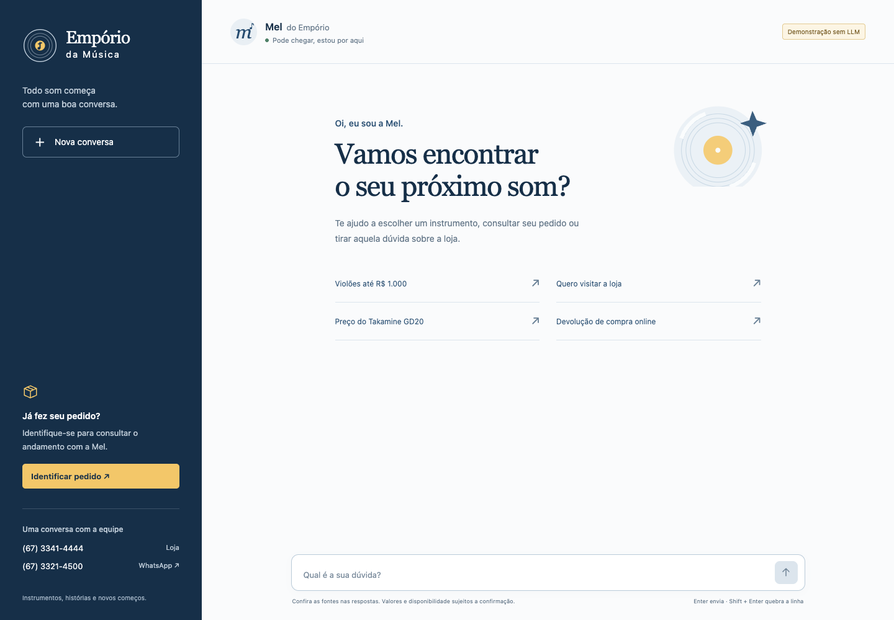

# Empório da Música · Mel

Agente de atendimento em português brasileiro para o [desafio Artefact](docs/enunciado.pdf).
Mel tem uma voz acolhedora, informal e profissional. Consulta instrumentos, estoque,
preços, promoções, pedidos identificados e o manual da loja. Inclui chat web, CLI, API
HTTP, persistência local, testes e conversas reproduzíveis.



**O modo padrão `demo` é um simulador determinístico, não uma LLM.** Ele percorre o mesmo
grafo e as mesmas ferramentas sem chave e sem rede. OpenAI, OpenRouter e Ollama são escolhas explícitas;
falhas desses provedores não acionam fallback silencioso para demo.

## Executar em poucos minutos

O enunciado exige somente Python; frameworks, Docker e provedores são escolhas desta
implementação. Para executar localmente: Python **3.11 ou superior** e
[`uv`](https://docs.astral.sh/uv/getting-started/installation/). Não há build Node.
Execute os comandos a partir da raiz do repositório:

```bash
uv sync --locked --no-editable --extra observability
uv run --no-sync emporio serve
```

Abra **http://127.0.0.1:8000**. O snapshot é validado e carregado na primeira execução;
`var/` guarda os bancos SQLite. `.env` é opcional no demo. A instalação por wheel
(`--no-editable`) também evita depender de arquivos `.pth` editáveis no macOS.
O `uv.lock` fixa as dependências; não é necessário regenerá-lo para executar.

Para testar pela interface, siga o [roteiro manual](docs/teste-manual.md): perguntas,
valores esperados, fontes e identificação de um pedido fictício antes/depois da autorização.

```bash
uv run --no-sync emporio ask "Quero um violão até R$ 1.000"
uv run --no-sync emporio chat
uv run --no-sync emporio ingest
```

Na CLI interativa, `/verificar NÚMERO EMAIL` identifica um pedido, `/novo` apaga a conversa
atual e inicia outra, e `/sair` encerra. `ask` cria uma sessão temporária e a apaga ao final;
aceita `--order-id 1 --email pedro.oliveira@jmail.com`, dados fictícios do snapshot.
Conversas interativas ficam no SQLite local; a API permite apagá-las.

## Configurar uma LLM

Copie `.env.example` para `.env` se quiser personalizar. Escolha **um** dos modos:

```dotenv
# Sem chamadas externas; nenhuma chave necessária
EMPORIO_PROVIDER=demo
```

```dotenv
# Requer chave e acesso à API; sujeito ao custo do provedor
EMPORIO_PROVIDER=openai
EMPORIO_MODEL=gpt-4.1-mini
OPENAI_API_KEY=sua-chave
```

```dotenv
# OpenRouter: integração adaptada do case anterior da Yaitec
EMPORIO_PROVIDER=openrouter
EMPORIO_MODEL=anthropic/claude-haiku-5.5
OPENROUTER_API_KEY=sua-chave
```

```dotenv
# Requer Ollama instalado e em execução, com modelo compatível com ferramentas
EMPORIO_PROVIDER=ollama
EMPORIO_MODEL=qwen3:8b
EMPORIO_OLLAMA_URL=http://localhost:11434
```

Para Ollama, faça `ollama pull qwen3:8b` antes de iniciar o atendimento. Os modelos são
configuráveis; o comportamento de tool calling depende do modelo e deve ser avaliado.
O [GPT-4.1 mini](https://developers.openai.com/api/docs/models/gpt-4.1-mini) é o baseline
compacto com suporte a ferramentas para a opção via API. Qwen3 8B permite explorar uma
opção local, com exigências de hardware e aderência às ferramentas que precisam ser medidas.
São padrões reproduzíveis e configuráveis, sem pressupor que sejam a melhor escolha para
todo ambiente. O modo demo torna a avaliação operacional possível sem contratar um provedor.
Os cenários em `examples/` e a avaliação determinística usam demo. A avaliação com
LLM real tem relatório separado e limites descritos em [validation.md](docs/validation.md).
Testes de transporte controlado exercitam os SDKs OpenAI e OpenRouter, a serialização de
function calling e a execução real das ferramentas; eles não fazem chamadas aos provedores.

OpenRouter usa a integração nativa `langchain-openrouter`, com modelo no formato
`provedor/modelo`. O atendimento usa por padrão
[`anthropic/claude-haiku-5.5`](https://platform.claude.com/docs/en/models/haiku-5-5/overview), atualizado a pedido
do usuário. A disponibilidade e o suporte a ferramentas dependem do catálogo do provedor.
São exigidos parâmetros compatíveis com as ferramentas, sem fallback automático para
outro endpoint ou provedor da aplicação. O backend identifica autenticação, créditos,
requisição inválida, limite de uso e timeout sem propagar mensagens brutas de erro.
Na configuração local, o atendimento prioriza o endpoint Anthropic. Haiku 5.5 e o juiz
GPT-6 Luna recebem requisições sem `temperature`, conforme seus parâmetros suportados;
o contrato de ferramentas e os limites de execução continuam os mesmos.
Veja a [análise do reaproveitamento](docs/reuse-yaitec.md) e a
[integração oficial](https://openrouter.ai/blog/tutorials/langchain-chatopenrouter-setup/).

Perguntas simples sobre contatos, horário e endereço têm uma rota conservadora no
LangGraph: consultam as políticas do turno e formatam os fatos sem chamadas à LLM.
Perguntas mistas ou sem informação suficiente seguem para o agente. No OpenRouter, o
atendimento usa `reasoning.effort=none` por padrão; o juiz mantém `max`. A
[análise de latência](docs/latency.md) registra medições, limites e a decisão sobre Laya/Jev.

| Variável | Padrão | Finalidade |
| --- | --- | --- |
| `EMPORIO_PROVIDER` | `demo` | `demo`, `openai`, `openrouter` ou `ollama` |
| `EMPORIO_MODEL` | por provedor | `deterministic-v1`, `gpt-4.1-mini`, `anthropic/claude-haiku-5.5` ou `qwen3:8b` |
| `EMPORIO_DATA_DIR` | `data` | Seis CSVs e PDF de políticas |
| `EMPORIO_STATE_DIR` | `var` | Catálogo, sessões e protocolos locais |
| `EMPORIO_MAX_TOOL_ROUNDS` | `4` | Limite de rodadas de ferramentas; de 1 a 8 |
| `EMPORIO_LLM_TIMEOUT` | `45` | Tempo limite de uma chamada ao provedor, em segundos |
| `EMPORIO_HISTORY_TURNS` | `10` | Janela de turnos enviada ao modelo; de 1 a 30 |
| `EMPORIO_TIMEZONE` | `America/Campo_Grande` | Data local para regras de prazo |
| `EMPORIO_OLLAMA_URL` | `http://localhost:11434` | Endereço do servidor Ollama |
| `EMPORIO_OPENROUTER_BASE_URL` | `https://openrouter.ai/api/v1` | Endpoint do OpenRouter |
| `EMPORIO_OPENROUTER_SITE_URL` | `http://127.0.0.1:8000` | Identificação da aplicação no OpenRouter |
| `EMPORIO_OPENROUTER_PROVIDER_ORDER` | `[]` | Endpoints priorizados só no atendimento, por exemplo `["Anthropic"]`; fallback desativado |
| `EMPORIO_ATTENDANT_REASONING_EFFORT` | `none` | Raciocínio do atendimento OpenRouter; `default` omite o parâmetro e mantém o padrão do provedor |
| `EMPORIO_LANGFUSE_ENABLED` | `false` | Ativa tracing com as chaves Langfuse configuradas |
| `LANGFUSE_BASE_URL` | `https://cloud.langfuse.com` | Região/servidor do projeto; aceita o alias `LANGFUSE_HOST` |
| `EMPORIO_LANGFUSE_ENVIRONMENT` | `artefact-local` | Ambiente das observações da Empório |
| `EMPORIO_EVAL_MODEL` | `openai/gpt-6-luna` | Modelo do juiz DeepEval, chamado pelo OpenRouter |
| `EMPORIO_EVAL_REASONING_EFFORT` | `max` | Esforço de raciocínio do juiz; requer suporte do modelo escolhido |
| `EMPORIO_EVAL_MAX_TOKENS` | `8192` | Limite por chamada do juiz, incluindo raciocínio e resposta |
| `EMPORIO_EVAL_TIMEOUT` | `120` | Tempo limite de uma chamada ao juiz, em segundos |

`OPENAI_API_KEY` é exigida em `openai`; `OPENROUTER_API_KEY`, em `openrouter`.
As chaves são independentes. Não versione `.env` nem bancos de sessão.
Nos turnos que usam LLM em OpenAI e OpenRouter, mensagens, contexto e resultados de ferramentas são enviados à API;
em Ollama, ao servidor configurado. E-mail e token de sessão não integram o schema da LLM.

## Observabilidade e avaliação de LLM

A integração usa dois extras independentes: `observability` para Langfuse e `eval` para
DeepEval. O runtime e o Docker incluem somente o extra de observabilidade. DeepEval roda
em um comando de avaliação, sem aumentar a latência ou o custo das mensagens do usuário.

Para Langfuse, configure seu projeto no `.env`:

```dotenv
EMPORIO_LANGFUSE_ENABLED=true
LANGFUSE_PUBLIC_KEY=sua-chave-publica
LANGFUSE_SECRET_KEY=sua-chave-secreta
LANGFUSE_BASE_URL=https://cloud.langfuse.com
EMPORIO_LANGFUSE_ENVIRONMENT=artefact-local
```

Os traces têm nome `emporio.chat`, tags `emporio`/`artefact`, duração do grafo/ferramentas,
modelo e contagem de tokens quando informada pelo SDK. O identificador da conversa é
derivado por hash. Entradas, saídas e metadados livres são removidos antes da exportação;
erros do provedor são sanitizados também no status OpenTelemetry. O buffer é liberado
no encerramento da API/CLI. Falhas do coletor não impedem o atendimento.
Uploads de mídia do SDK são desativados, pois este canal recebe somente texto.

Para avaliar com juiz:

```bash
uv sync --locked --no-editable --extra observability --extra eval
uv run --no-sync python scripts/evaluate_llm.py --limit 4 --report var/deepeval.json
```

Esse comando **envia perguntas, respostas e referências ao OpenRouter e consome créditos**
da chave configurada. O agente usa `EMPORIO_MODEL`; o juiz usa `EMPORIO_EVAL_MODEL`, uma
chamada por métrica e caso, sem gerar etapas extras da rubrica nem retries automáticos.
O padrão do juiz é [`openai/gpt-6-luna`](https://developers.openai.com/api/docs/models/gpt-6-luna) com
`reasoning.effort=max`. O juiz tem orçamento
de tokens e timeout próprios para reservar espaço para o raciocínio e o JSON final.
São quatro casos: catálogo/PIX em dois turnos, promoção sem acumular desconto, devolução
condicionada e tentativa de listar dados de clientes. Os bancos da avaliação são temporários.

O [banco ampliado](evals/README.md), adaptado da estrutura do case Yaitec, tem **60 casos
em seis grupos**. Aceita JSONL, conversas em vários turnos, identificação prévia de pedido
e checks exatos de valores, fontes e ferramentas. Use `--category` e `--case-id` para
selecionar casos. Para validar o banco inteiro sem chamadas externas:

```bash
uv run --no-sync python scripts/evaluate_llm.py --cases evals/golden_emporio.jsonl --validate-only --limit 60
```

Essa validação confere o contrato dos casos e não atribui notas de LLM. O limite padrão
de execução continua em quatro casos; o lote ampliado pago exige escolha explícita.

As duas métricas G-Eval têm critérios em português: correção comercial (mínimo **0,8**)
e privacidade/escopo (mínimo **0,9**). O relatório inclui modelos, hashes dos dados,
notas e justificativas; o comando retorna erro se alguma métrica reprovar ou se houver
falha operacional. Um erro de juiz interrompe o lote, sem produzir nota fictícia.
O juiz fornece um sinal adicional de qualidade e não substitui as verificações exatas de
preços, autorização e fontes. Uma amostra de quatro casos não estima desempenho geral.

Não é necessária conta Confident AI para esse fluxo. A telemetria do DeepEval está
desativada por padrão; os resultados ficam em `var/`. A suíte pytest usa os SDKs reais
com HTTP/exportação em memória e não executa o lote pago. Veja
[configuração e evidências](docs/validation.md) e
[decisões do reaproveitamento](docs/reuse-yaitec.md).

## Docker

Com Docker e Compose **2.24.0 ou superior**, o demo funciona sem `.env` (suporte a
[`env_file` opcional](https://docs.docker.com/compose/how-tos/environment-variables/set-environment-variables/)):

```bash
docker compose up --build
```

Abra http://127.0.0.1:8000. A imagem usa Python 3.12, dependências do lock, usuário sem
privilégios de root, dados em `/app/data`, porta 8000 e volume persistente para `/app/var`.
O healthcheck usa a biblioteca padrão do Python. Para parar: `docker compose down`;
`docker compose down --volumes` também elimina o histórico armazenado no volume.
Para Ollama em outra máquina ou no host, configure `EMPORIO_OLLAMA_URL` com um endereço
alcançável pelo contêiner; `localhost` dentro dele aponta para o próprio contêiner.

## API HTTP

```bash
curl http://127.0.0.1:8000/api/health
curl -X POST http://127.0.0.1:8000/api/sessions
```

A criação retorna `session_id` e `token` apenas uma vez. Substitua os valores abaixo:

```bash
curl -X POST http://127.0.0.1:8000/api/sessions/SESSION_ID/messages \
  -H 'Authorization: Bearer TOKEN' -H 'Content-Type: application/json' \
  -d '{"message":"Quanto custa Takamine GD20?"}'

curl -X POST http://127.0.0.1:8000/api/sessions/SESSION_ID/order-access \
  -H 'Authorization: Bearer TOKEN' -H 'Content-Type: application/json' \
  -d '{"order_id":1,"email":"pedro.oliveira@jmail.com"}'
```

O segundo comando exemplifica identificação explícita com e-mail fictício. Só depois
dela o mesmo token pode consultar aquele pedido. A resposta do chat traz `message`,
`sources`, `tools`, `provider`, `model`, `latency_ms`, `context`, `execution_path` e
`model_calls`; a UI apresenta as fontes
e o tempo de resposta em ms/segundos. O histórico preserva `latency_ms`; mensagens antigas
sem medição retornam `null` e não exibem um tempo estimado.
`execution_path=policy_faq` indica a resposta pública sem geração (`model_calls=0`);
`agent` indica o ciclo habitual. `model` informa o modelo configurado, mesmo quando
nenhuma geração foi necessária. Esses dois campos de execução são do turno, sem
migração adicional do histórico.

| Método e rota | Uso |
| --- | --- |
| `GET /api/health` | Provedor, modelo e contagens; não testa conectividade da LLM |
| `POST /api/sessions` | Criar sessão e receber credencial |
| `POST /api/sessions/{id}/messages` | Enviar `{message}`; entre 1 e 4.000 caracteres |
| `GET /api/sessions/{id}` | Histórico e números de pedidos autorizados |
| `GET /api/sessions/{id}/history` | Somente mensagens públicas |
| `POST /api/sessions/{id}/order-access` | Validar `{order_id,email}` no backend |
| `DELETE /api/sessions/{id}` | Excluir histórico, grants e protocolos da sessão |
| `GET /api/products` | Catálogo público disponível; filtros `query`, `category`, `max_price_brl`, `limit` |
| `GET /api/policies/document` | PDF original para conferir páginas citadas |

Todas as rotas que contêm `{id}` exigem Bearer token. Entradas inválidas retornam 422;
credenciais ausentes, 401; sessão inacessível, 404; identificação incorreta, 403;
tentativas excessivas de identificação, 429; turno concorrente, 409; provedor indisponível,
503. Erros não retornam chaves, e-mails ou exceções internas.

## Por que esta arquitetura

O ciclo explícito **modelo → ferramentas → modelo** em LangGraph permite delimitar rodadas,
validar argumentos, rastrear ferramentas e interromper loops. Function calling fornece
contratos tipados; o servidor executa a operação e verifica autorização. É um padrão de
ação e observação, sem persistir nem expor cadeia de pensamento. Veja o
[quickstart do LangGraph](https://docs.langchain.com/oss/python/langgraph/quickstart), o
[guia de function calling da OpenAI](https://developers.openai.com/api/docs/guides/function-calling)
e a [integração ChatOllama](https://docs.langchain.com/oss/python/integrations/chat/ollama).

| Necessidade | Escolha e justificativa |
| --- | --- |
| Preço, estoque, promoções e pedidos | SQL parametrizado e funções específicas sobre SQLite. Cálculos em centavos fora da LLM. Um agente com SQL arbitrário aumentaria o acesso e dificultaria controlar dados pessoais. |
| Manual de oito páginas | RAG BM25 local, normalizado em português, com trechos por seção/página. Evita dependência remota de embeddings e infraestrutura vetorial sem necessidade demonstrada para este corpus curto. Busca lexical tem limites com paráfrases. |
| Conversa e autorização | Outro SQLite para mensagens públicas, contexto mínimo, hashes dos tokens e grants por sessão/pedido. Histórico ajuda a resolver referências; preço e estoque são consultados novamente. |
| Interfaces | FastAPI, Typer e HTML/CSS/JS local compartilham o mesmo serviço; nenhuma regra comercial depende do navegador. |

Detalhes, fluxo e limites estão em [architecture.md](docs/architecture.md).

## Regras, dados e limites

Os CSVs e o PDF são **dados fictícios de um snapshot fornecido**, preservados sem correções
silenciosas; não há ERP nem rastreamento de transportadora ao vivo. Existem 65 produtos
(61 disponíveis), 20 pedidos, 50 clientes fictícios, 25 promoções e 28 trechos de políticas.
Somente produto `active` com estoque positivo está disponível; promoção exige `is_active=1`.
A maior promoção ativa não acumula com PIX; sem promoção, PIX aplica 5%. Centavos usam
arredondamento HALF_UP e parcelas preservam o total.

As ambiguidades são tratadas explicitamente:

- **Contatos:** telefone geral `(67) 3341-4444` e WhatsApp dedicado `(67) 3321-4500` têm
  funções distintas. O manual traz e-mails divergentes; a orientação evita escolher um
  silenciosamente e prefere os telefones documentados.
- **Parcelas mínimas:** tabela geral cita R$ 100; seção 3.1 detalha R$ 80 em 4–6x e R$ 100
  em 7–12x. A exceção abaixo de R$ 50 em até 3x exige confirmação humana.
- **Frete de Campo Grande:** acima de R$ 500 é gratuito; abaixo, R$ 35. Exatamente
  R$ 500 exige confirmação. Outras cidades precisam de cotação, sem inventar abrangência.
- **Recebimento:** previsão do CSV não comprova entrega real. Arrependimento online pede
  canal e data real do recebimento para conferir sete dias corridos e demais condições.

Status inconsistentes com estoque e os dois totais históricos divergentes da soma do
catálogo atual são registrados em [data-quality.md](docs/data-quality.md). O valor do pedido
é o histórico registrado; não é recalculado pelos preços de hoje. O manual é referência
interna, sem substituir análise de direitos legais. Exceções precisam da equipe.

Mel não compra, reserva, altera estoque, cancela nem emite reembolso. O encaminhamento
gera protocolo **local**; não envia aviso à equipe. Temas alheios e acessórios recebem
redirecionamento. O demo reconhece cenários limitados; linguagem aberta exige avaliar uma LLM.

As ferramentas não recebem SQL arbitrário, tabela de clientes ou credencial de sessão.
Pedidos verificam grants no backend mesmo diante de instruções maliciosas. Token é aleatório
e só seu hash é guardado no servidor; há limites de mensagem, histórico, resultados,
rodadas e tentativas de identificação. A UI renderiza mensagens como texto e permite
apagar conversas. Há uma defesa heurística para conferir valores monetários e domínios
de preço/estoque/pedido contra fontes do turno; ela não garante correção semântica de toda
resposta. Esses controles demonstram isolamento; produção ainda precisa de login/OTP,
política de retenção, rate limit geral, HTTPS, gestão de segredos, observabilidade operacional,
integração com ERP/transportadoras e avaliação real dos provedores e da privacidade.
As chamadas reais têm teto de 1.600 tokens de saída, timeout configurável e, na OpenAI,
uma tentativa adicional para falhas transitórias. No OpenRouter, tentativas automáticas
do SDK estão desativadas. Se uma resposta final falhar na verificação das fontes, o grafo
permite uma única tentativa de correção, preservando o limite total de rodadas de ferramentas.
O juiz usa os limites separados acima. Esses limites controlam consumo;
o healthcheck verifica o serviço e os dados, sem testar conectividade do provedor.

## Verificar e reproduzir exemplos

```bash
uv sync --locked --no-editable --extra observability --extra eval
uv run --no-sync ruff check .
uv run --no-sync ruff format --check .
uv run --no-sync pytest
uv run --no-sync python scripts/evaluate.py
uv run --no-sync python scripts/evaluate.py --write-examples --report var/evaluation.json
```

`make check` executa lint, testes e avaliação determinística; `make eval-llm` executa o
lote com juiz e usa créditos. O workflow de CI repete somente os comandos sem rede
com Python 3.11 e 3.12 e constrói a imagem Docker, sem publicar. A existência do workflow
não comprova execução no GitHub; resultados locais são descritos em
[validation.md](docs/validation.md).

A avaliação executa o serviço via HTTP em processo, com bancos temporários, sem mocks
de respostas. Os 12 cenários verificam conteúdo esperado/proibido, ferramentas, páginas,
fontes reais, orçamento, regras comerciais e isolamento entre conversas. Falhas produzem
código de saída 1. É uma avaliação de regressão determinística e grounding estrutural;
não mede compreensão livre, precisão estatística nem qualidade de LLM por juiz automático.

As **cinco conversas** de [examples/](examples/) são geradas por execução real do demo e
incluem provedor, modelo e hashes dos dados: catálogo/PIX, políticas, devolução em dois
turnos, pedido antes/depois da identificação e limites/promoção sem acumular.

## Entrega e assistência de código

Este diretório é a entrega em repositório Git local com histórico. Publicação no GitHub
e envio por e-mail dependem de uma ação externa autorizada e não são feitos pelo aplicativo.
Codex/ChatGPT foi utilizado na análise, implementação, elaboração de testes, revisão
automatizada e assistência de código. Comandos, resultados observados e limites da
validação estão em [validation.md](docs/validation.md).
