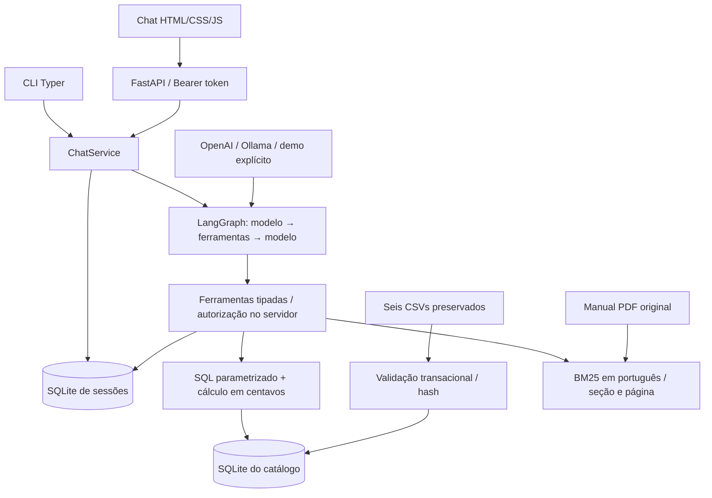

# Arquitetura

O serviço atende em português com a persona Mel. O enunciado exige Python; a arquitetura
foi escolhida para tornar decisões comerciais e acesso a pedidos verificáveis. O modo
demo é um simulador determinístico: exercita o caminho operacional, sem ser uma LLM.

## Ciclo de uma resposta

1. HTTP autentica o Bearer token pelo hash salvo, limita a entrada e adquire o turno da
   sessão para impedir respostas concorrentes na mesma conversa.
2. O serviço lê a janela de histórico (10 turnos por padrão), o contexto mínimo e a data
   local de Campo Grande. Histórico pode resolver “o primeiro”; não é fonte de preços.
3. O modelo produz resposta ou chamadas de ferramentas. O grafo executa ferramentas
   conhecidas com validação Pydantic, registra duração/resultado e retorna observações
   ao modelo. O padrão tem ação e observação, sem salvar raciocínio interno.
4. Fontes vêm dos resultados das ferramentas, com IDs, referências e páginas reais.
   O serviço salva mensagens públicas finais e contexto mínimo: IDs de produtos e canal,
   motivo e datas de uma devolução. O trace completo de argumentos e observações não é
   persistido; credenciais e cadeia de pensamento não integram o histórico público.

O grafo limita por padrão quatro rodadas e oito chamadas por rodada. Há limites para
comprimento de mensagem, quantidade de resultados e tempo de uma chamada de LLM. Uma
chamada com nome desconhecido ou argumentos inválidos produz erro estruturado. Falha de
provedor é tratada sem expor exceção ou segredo; não troca de provedor silenciosamente.

O ciclo segue o [quickstart do LangGraph](https://docs.langchain.com/oss/python/langgraph/quickstart).
O contrato de ação se apoia em [function calling](https://developers.openai.com/api/docs/guides/function-calling)
e na [integração ChatOllama](https://docs.langchain.com/oss/python/integrations/chat/ollama).
São referências de implementação; a qualidade final depende do modelo escolhido.

## Ferramentas e fronteiras

| Ferramenta | Evidência e controle |
| --- | --- |
| `search_products` / `get_product` | SQL parametrizado, busca/filtros limitados, status e estoque atuais do snapshot |
| `quote_product` | Regras em Python, centavos inteiros, HALF_UP, maior promoção ativa, PIX sem acumular, parcelas e frete |
| `search_policies` | RAG lexical BM25 com normalização/expansão em português, trechos com seção e página do PDF |
| `assess_return` | Canal e datas reais, condições e prazos; orientação condicional, sem autorizar reembolso |
| `get_order` | Grant verificado dentro da ferramenta, vinculado à sessão e ao número do pedido |
| `create_support_ticket` | Protocolo local após pedido de atendimento; não envia mensagem externa |

A LLM não escreve SQL nem recebe uma ferramenta genérica de banco. Isso reduz o conjunto
de operações e preserva autorização e regras de preço em código. Não existem ferramentas
para comprar, alterar estoque, cancelar, reembolsar ou enviar notificações.

BM25 atende um corpus de oito páginas sem servidor de vetores ou embeddings remotos.
Os 28 trechos respeitam seções e páginas; seções extensas podem ter sobreposição. Fontes
de cálculos comerciais apontam para as seções que implementam. A escolha simplifica
reprodução e inspeção; recuperação lexical pode falhar em paráfrases ou perguntas vagas.
Não se afirma superioridade empírica a vetores: faltaria comparação em corpus ampliado.

## Dados, memória e segurança

O catálogo SQLite é reconstruído transacionalmente quando o hash dos seis CSVs muda.
O PDF tem hash próprio e índice local. Os arquivos originais continuam em `data/`.
Não há atualização do snapshot por ERP; “atual” significa a carga disponível no processo.

Outro SQLite guarda sessões, hash do token aleatório, mensagens públicas, contexto mínimo,
grants e protocolos locais. A autorização usa número e e-mail verificados no backend por
uma ação explícita fora do modelo. O grant vale somente para aquele pedido naquela sessão;
não é uma autenticação forte e não substitui login/OTP. Há limitação de tentativas da
identificação, mas não rate limit geral. Exclusão da sessão remove seu histórico, grants
e protocolos. Não há rotina automática de retenção.

HTTP evita CORS amplo, aplica headers de proteção e usa a mesma origem para estáticos.
A UI usa texto em mensagens; instruções recebidas em mensagens ou no PDF não devem
substituir a política do sistema. Autorização e SQL controlado continuam aplicados no
backend independentemente da obediência da LLM ao prompt. Isso reduz riscos, sem
demonstrar imunidade a toda prompt injection ou a toda afirmação sem suporte textual.
Uma verificação heurística adicional confronta valores monetários e domínios comerciais
com as fontes do turno; não é uma garantia semântica nem comprova qualidade de LLM real.

## Verificação e evolução

`scripts/evaluate.py` executa HTTP em processo com `TestClient`, o serviço e bancos reais
temporários, demo explícito e nenhum mock de resposta. Verifica 12 cenários, fontes,
ferramentas, textos esperados/proibidos e restrições. Gera as cinco conversas em
`examples/`, com hashes dos dados, sem LLM juiz. Os testes unitários e de integração
cobrem regras e fronteiras adicionais. A avaliação não comprova desempenho com OpenAI
ou Ollama nem qualidade de linguagem aberta; isso requer execução explícita desses modelos.

Para produção faltam autenticação forte, retenção e consentimento definidos, rate limit
geral, HTTPS, gestão de segredos, operação/monitoramento, avaliações reais e integrações
com ERP, transporte e equipe de atendimento. Pedidos históricos mantêm seus totais
registrados, mesmo quando divergentes dos preços atuais; veja [data-quality.md](data-quality.md).
