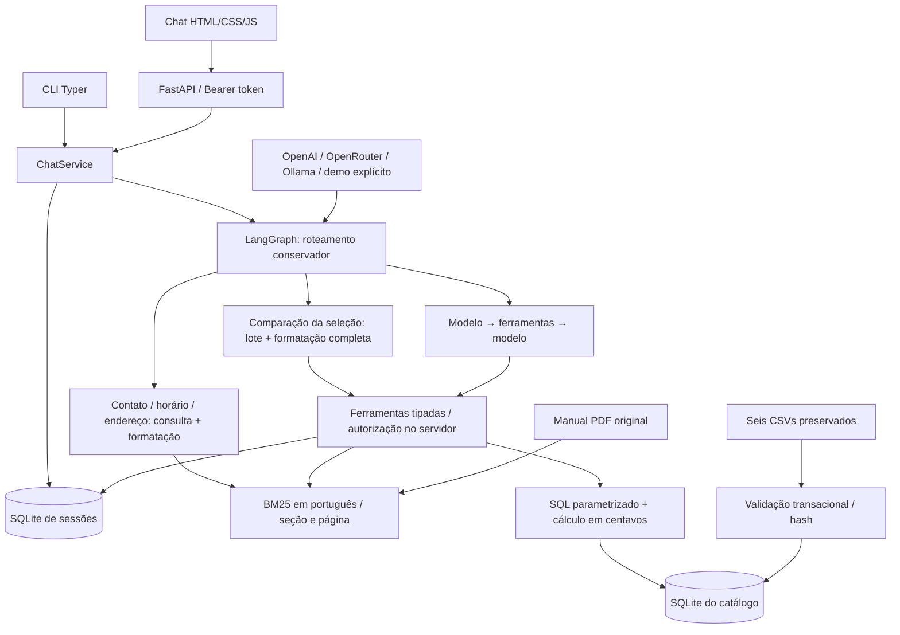

# Arquitetura

O serviço atende em português com a persona Mel. O enunciado exige Python; a arquitetura
foi escolhida para tornar decisões comerciais e acesso a pedidos verificáveis. O modo
demo é um simulador determinístico: exercita o caminho operacional, sem ser uma LLM.

## Ciclo de uma resposta

1. HTTP autentica o Bearer token pelo hash salvo, limita a entrada e adquire o turno da
   sessão para impedir respostas concorrentes na mesma conversa.
2. O serviço lê a janela de histórico (10 turnos por padrão), o contexto mínimo e a data
   local de Campo Grande. Histórico pode resolver “o primeiro”; não é fonte de preços.
3. Perguntas simples de contato, horário ou endereço passam por uma lista conservadora
   de intenções e vocabulário. O nó `public_info` executa `search_policies` e extrai os
   fatos das fontes recuperadas, sem LLM; não guarda um cache de respostas. Perguntas
   mistas, privadas, com ações ou sem fatos suficientes seguem para o modelo.
   O modelo produz resposta ou chamadas de ferramentas. O grafo executa ferramentas
   conhecidas com validação Pydantic, registra duração/resultado e retorna observações
   ao modelo. O padrão tem ação e observação, sem salvar raciocínio interno.
   Se a resposta final não tiver evidência suficiente, uma única tentativa de correção
   solicita nova consulta e preserva o orçamento total de rodadas. Valores de economia
   são calculados no backend e só sustentam menções a desconto, não o preço do produto.
   A correção descarta o rascunho rejeitado, que não foi exibido ao cliente, mantendo
   as chamadas de ferramentas e o histórico público anterior. A nova resposta preserva
   a intenção da pergunta; uma listagem não é convertida em cotação de um único item.
4. Fontes vêm dos resultados das ferramentas, com IDs, referências e páginas reais.
   O modelo recebe os fatos e os trechos integrais em `policy_context`, sem o envelope
   de metadados `sources`. O backend mantém os resultados completos para a verificação
   de evidência, avaliação e área de fontes. A apresentação remove atribuições internas
   reconhecíveis; condições sobre o manual físico do produto continuam no texto.
   O serviço salva mensagens públicas finais e contexto mínimo: IDs de produtos e canal,
   motivo e datas de uma devolução. O trace completo de argumentos e observações não é
   persistido; credenciais e cadeia de pensamento não integram o histórico público.

O grafo limita por padrão quatro rodadas e oito chamadas por rodada. Há limites para
comprimento de mensagem, quantidade de resultados e tempo de uma chamada de LLM. Uma
chamada com nome desconhecido ou argumentos inválidos produz erro estruturado. Falha de
provedor é tratada sem expor exceção ou segredo; não troca de provedor silenciosamente.

Uma referência simples de PIX e parcelado a um grupo da seleção anterior tem um nó
conservador de comparação. Os IDs da seleção são mantidos pelo servidor; a ferramenta
em lote filtra apenas esses IDs por nome/descrição e reconsulta preços e estoque atuais.
Calcula as duas formas para cada produto e formata todos os resultados em código,
incluindo indisponibilidade e condições inválidas. Não há resumo generativo que possa
omitir metade da lista. Na ausência de parcelas, mostra 3x como exemplo explícito.
Quantidades, cidades, negações ou pedidos mistos ficam no agente. A mesma ferramenta
pode ser escolhida pela LLM; nessa situação o ciclo continua para responder aos demais
assuntos. O guard exige nomes completos e valores de todos os resultados válidos do
lote, com uma única tentativa de correção em caso de omissão. Várias cotações preservam
todos os IDs, em vez de só o último.

O ciclo segue o [quickstart do LangGraph](https://docs.langchain.com/oss/python/langgraph/quickstart).
O contrato de ação se apoia em [function calling](https://developers.openai.com/api/docs/guides/function-calling)
e na [integração ChatOllama](https://docs.langchain.com/oss/python/integrations/chat/ollama).
São referências de implementação; a qualidade final depende do modelo escolhido.
O raciocínio do atendimento OpenRouter é configurável e usa `none` por padrão;
o juiz de avaliação continua separado, com `max`. Veja as
[medições e decisões de latência](latency.md), incluindo os limites da rota de FAQ.

## Ferramentas e fronteiras

| Ferramenta | Evidência e controle |
| --- | --- |
| `search_products` / `get_product` | SQL parametrizado, busca/filtros limitados, status e estoque atuais do snapshot |
| `quote_product` | Regras em Python, centavos inteiros, HALF_UP, maior promoção ativa, PIX sem acumular, parcelas e frete |
| `quote_products` | Compara todos os IDs selecionados em PIX e crédito, uma unidade por modelo, sem frete; 3x como exemplo se não houver quantidade de parcelas |
| `search_policies` | RAG lexical BM25 com normalização/expansão em português, trechos com seção e página do PDF |
| `assess_return` | Canal e datas reais, condições e prazos; orientação condicional, sem autorizar reembolso |
| `get_order` | Grant verificado dentro da ferramenta, vinculado à sessão e ao número do pedido |
| `create_support_ticket` | Protocolo local após pedido de atendimento; não envia mensagem externa |

A LLM não escreve SQL nem recebe uma ferramenta genérica de banco. Isso reduz o conjunto
de operações e preserva autorização e regras de preço em código. Não existem ferramentas
para comprar, alterar estoque, cancelar, reembolsar ou enviar notificações.

BM25 atende um corpus de oito páginas sem servidor de vetores ou embeddings remotos.
Os 28 trechos respeitam seções e páginas; seções extensas podem ter sobreposição. Fontes
de cálculos comerciais apontam para as seções que implementam. A escolha simplifica
reprodução e inspeção; recuperação lexical pode falhar em paráfrases ou perguntas vagas.
Não se afirma superioridade empírica a vetores: faltaria comparação em corpus ampliado.

## Dados, memória e segurança

O catálogo SQLite é reconstruído transacionalmente quando o hash dos seis CSVs muda.
O PDF tem hash próprio e índice local. Os arquivos originais continuam em `data/`.
Não há atualização do snapshot por ERP; “atual” significa a carga disponível no processo.

Outro SQLite guarda sessões, hash do token aleatório, mensagens públicas, contexto mínimo,
grants e protocolos locais. A autorização usa número e e-mail verificados no backend por
uma ação explícita fora do modelo. O grant vale somente para aquele pedido naquela sessão;
não é uma autenticação forte e não substitui login/OTP. Há limitação de tentativas da
identificação, mas não rate limit geral. Exclusão da sessão remove seu histórico, grants
e protocolos. Não há rotina automática de retenção.

HTTP evita CORS amplo, aplica headers de proteção e usa a mesma origem para estáticos.
A UI usa texto em mensagens; instruções recebidas em mensagens ou no PDF não devem
substituir a política do sistema. Autorização e SQL controlado continuam aplicados no
backend independentemente da obediência da LLM ao prompt. Isso reduz riscos, sem
demonstrar imunidade a toda prompt injection ou a toda afirmação sem suporte textual.
Uma verificação heurística adicional confronta valores monetários e domínios comerciais
com as fontes do turno; não é uma garantia semântica nem comprova qualidade de LLM real.
Rótulos conservadores de orçamento podem repetir o teto realmente executado em
`search_products`. Isso não libera esse valor como preço, frete ou desconto. Contadores
nesses rótulos precisam corresponder ao tamanho do resultado e aparecer antes da
categoria/seleção, distinguindo “6 opções” de um identificador como “produto 95”.

Quando a busca textual cita uma única família cadastrada, o catálogo infere essa
categoria se ela foi omitida, preservando os filtros de marca e a categoria explícita.
Assim, um ukulele que menciona “violão” na descrição não entra na busca por violões.

## Verificação e evolução

`scripts/evaluate.py` executa HTTP em processo com `TestClient`, o serviço e bancos reais
temporários, demo explícito e nenhum mock de resposta. Verifica 12 cenários, fontes,
ferramentas, textos esperados/proibidos e restrições. Gera as cinco conversas em
`examples/`, com hashes dos dados, sem LLM juiz. Os testes unitários e de integração
cobrem regras e fronteiras adicionais. A avaliação não comprova desempenho com OpenAI,
OpenRouter ou Ollama nem qualidade de linguagem aberta; isso requer execução desses modelos.

## Reaproveitamento do case Yaitec

O provedor OpenRouter e a classificação de erros foram adaptados dos padrões do case
anterior do autor. Aqui a integração nativa `ChatOpenRouter` participa do mesmo ciclo
de function calling, com autorização das ferramentas preservada no servidor. O contrato
de geração JSON do RAG anterior não é usado no lugar das chamadas de ferramentas.
Chave própria, identificação da aplicação, timeout convertido para milissegundos e
tentativas do SDK desativadas são verificados por transporte HTTP controlado.
O [levantamento de componentes](reuse-yaitec.md) distingue o que foi adaptado das
evoluções possíveis em avaliação, observabilidade e retrieval.

## Observabilidade e qualidade opcionais

Langfuse observa o grafo por um callback novo a cada turno. O SDK registra spans de modelo
e ferramentas, duração e tokens disponíveis, com sessão derivada por hash e tags da Empório.
Uma máscara de exportação omite conteúdo e metadados livres. Erros de callback também são
sanitizados no status OTel. Upload de mídia é desativado antes de construir o cliente, pois
o SDK processa mídia antes de aplicar máscaras. O buffer é liberado no encerramento HTTP/CLI;
falhas de telemetria são independentes da resposta do agente.

DeepEval é instalado somente pelo extra `eval` e executado por `scripts/evaluate_llm.py`.
O carregador de JSON/JSONL e os checks exatos independem do SDK e da rede. O runner
confere valores, fontes e ferramentas antes de consolidar a aprovação com as duas
métricas; registra contagens por grupo e aplica identificação prévia pelo backend quando
definida no caso. O modo `--validate-only` não instancia o agente ou o juiz.
O adaptador schema-aware usa OpenRouter como juiz; duas métricas G-Eval com etapas fixas
verificam correção comercial e privacidade/escopo. A aplicação avaliada usa suas ferramentas
reais e sessões isoladas; o relatório fica local, com notas, justificativas e hashes dos dados.
Falhas operacionais e notas inválidas interrompem o lote. Isso complementa as regressões
determinísticas de preços/autorização e não participa do caminho de resposta ao cliente.

Para produção faltam autenticação forte, retenção e consentimento definidos, rate limit
geral, HTTPS, gestão de segredos, operação/monitoramento, avaliações reais e integrações
com ERP, transporte e equipe de atendimento. Pedidos históricos mantêm seus totais
registrados, mesmo quando divergentes dos preços atuais; veja [data-quality.md](data-quality.md).
